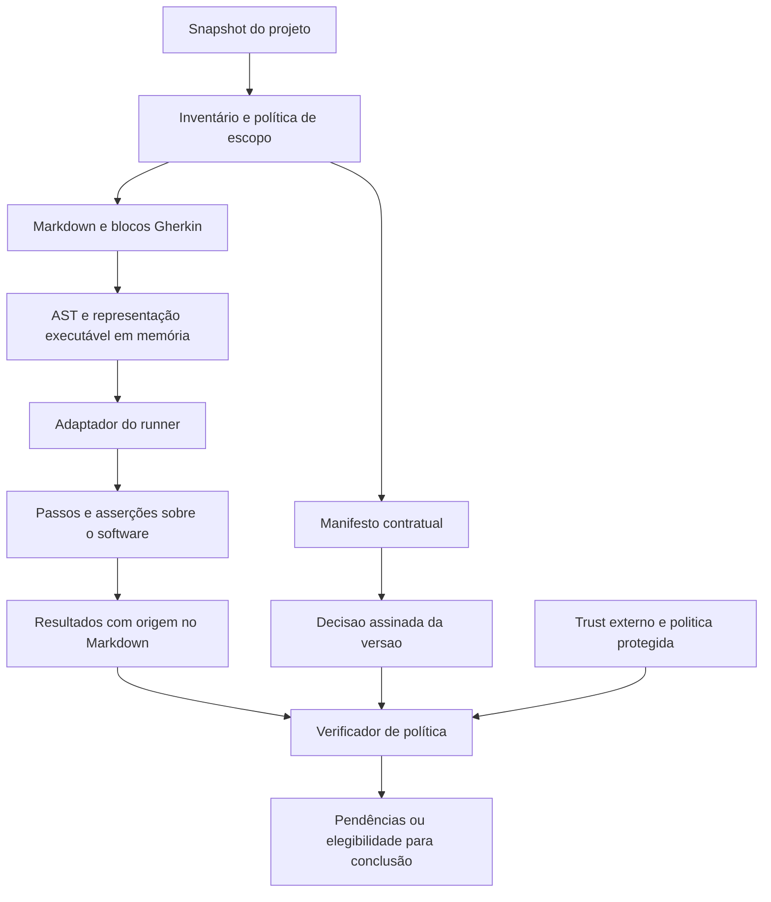

# Arquitetura experimental e desenho do produto

O projeto já implementa inventário, parsing de contratos, propostas de revisão, decisões Ed25519, execução de cenários e avaliação de evidências em um ciclo experimental Python. Há adaptadores de agentes e [pesquisas de runners](runner-feasibility.md). O [estado da implementação](implementation-status.md) distingue essas capacidades das provas de instalação e das pendências; o [primeiro preflight Codex](experimental-codex.md) documenta o incremento anterior.

O ciclo local não autentica a identidade humana nem estabelece isolamento de autoridade. Não há serviço produtivo de aprovação ou autenticação GitHub/OAuth. O comando de verificação implementa condições para execução protegida, mas um gate de integração confiável depende de pacote, workflow, política e permissões provisionados fora do controle do agente. Publicar esta documentação não constitui aceite contratual do conteúdo.

Leia também [produto](product.md), [requisitos](requirements.md), [formato](format.md), [aceite e confiança](approval-and-trust.md), [indexação](indexing.md), [integrações](integrations.md), [roadmap](roadmap.md) e [plano de validação](validation-plan.md).

## Restrição central: Markdown é a fonte canônica

O contrato é escrito, revisado e versionado em Markdown. Seus cenários Gherkin ficam no mesmo documento que explica os requisitos correspondentes.

A execução implementada extrai blocos Gherkin do Markdown e fornece conteúdo e origem em memória aos adaptadores, sem exigir arquivos `.feature` mantidos ou temporários. O worker Python integra Behave; Java e Go usam comandos de bridge configurados, cujo protocolo e implementação precisam corresponder ao runtime escolhido. Os runners Cucumber não devem ser presumidos capazes de ler qualquer sintaxe Markdown diretamente.

A viabilidade inicial dessa integração foi demonstrada nos protótipos Java, Python e Go; estabilidade das APIs, cobertura da gramática e integração com projetos reais continuam exigindo validação. Se um runner escolhido exigir arquivos `.feature`, essa integração ainda não satisfaz o requisito do produto; o projeto deverá escolher outro ponto de integração, adaptar o executor ou rever a escolha do runner com decisão explícita. Gerar uma segunda especificação editável não é uma solução aceita para esse problema.

As implementações dos passos continuam sendo código de teste. Elas exercitam o software e fazem as asserções descritas nos cenários; não se tornam uma segunda fonte de requisitos em linguagem natural.

## Componentes e responsabilidades

| Componente | Implementação atual | Fronteira e limitações |
| --- | --- | --- |
| Inventário e parser Markdown | Descoberta, metadados, requisitos, blocos, hashes e origem em `core.py`. | A política de escopo e o snapshot precisam corresponder ao ambiente pretendido. |
| Classificação | Declarações `behavioral`, `reference` e `mixed` entram na revisão. | Classificação semântica por IA não está implementada; declarar não equivale a aceitar. |
| Parser Gherkin | Parsing, IDs e instâncias de cenários no núcleo. | Reconhecer sintaxe e vínculos não prova cobertura da prosa. |
| Adaptadores de execução | Worker Python/Behave e protocolo para bridges Java/Go em `runner.py`. | Código de steps não é sandboxed; procedência do bridge e força das asserções precisam de revisão. |
| Revisão | Propostas com texto exato e interface local. | O campo de identidade da pessoa é autodeclarado; não há login humano por provedor. |
| Decisões assinadas | Ed25519, contexto, revogação de chave e registro externo da decisão vigente em `authority.py`. | Inicialização produz somente `local_demo`; assinatura comprova chave autorizada, não autenticação humana. |
| Ciclo e evidência | `workflow.py` relaciona contrato, código, vínculos, decisão e resultados. | Estado reaproveitado localmente não concede aprovação protegida. |
| Adaptadores dos agentes | Integrações específicas Codex e Claude Code. | Protocolo e provas por host estão no estado da implementação; não há equivalência universal entre eventos. |
| Verificação protegida | Caminho `verify` exige execução atual real, trust protegido e vínculos estritos. | A proteção operacional do pacote, do workflow e da política precisa existir fora do agente. |
| Índice e cache | Dados locais derivados para observação e desempenho. | Podem ser reconstruídos; não constituem autoridade de aprovação. |

O núcleo é utilizável por CLI com resultados estruturados. Os adaptadores conectam esse núcleo aos agentes; não mantêm autoridades de aceite distintas por plataforma.

## Pipeline de execução sem `.feature`

Cada cenário executável deve preservar pelo menos:

- Identificador do documento e do requisito ao qual está vinculado.
- Identificador estável do cenário e tags aplicáveis.
- Caminho do Markdown e posição do bloco e do cenário para diagnóstico.
- Hash do contrato e revisão do código usados na execução.
- Versão do parser, adaptador, runner e configuração pertinente.

Linhas e colunas ajudam a navegar, mas não servem como identidade estável: inserir um parágrafo pode deslocá-las. Os identificadores e o conteúdo do contrato devem permanecer distinguíveis das posições de apresentação.

O núcleo atual também representa `Rule`, `Background` e instâncias de `Scenario Outline`, preservando vínculos e origem. A gramática aceita pelo parser não garante paridade de execução de todos os runtimes; cada bridge precisa demonstrar o subconjunto que executa. Resultados vazios, cenários ausentes, indefinidos ou ignorados não contam como execução bem-sucedida.

## Quatro estados que não devem ser confundidos

### Contrato

Contém o texto e os cenários que definem o comportamento pretendido. Sua classificação também é uma afirmação sujeita ao aceite: declarar um documento como informativo não deve conceder automaticamente uma dispensa.

Uma proposta de revisão identifica conteúdo e escopo por hash determinístico. Alterar documentação, classificação, configuração ou mapa de vínculos cria uma identidade diferente. Os resultados do ciclo implementado aparecem na seção de estados abaixo.

### Aceite

O mecanismo implementado registra uma decisão assinada sobre uma versão e contexto. A chave precisa estar autorizada para projeto/repositório e não revogada; o registro externo fixa a decisão vigente. O aceite anterior continua histórico e não autoriza conteúdo novo. No modo local, o nome informado é autodeclarado e a chave pode estar acessível à mesma identidade do agente: isso não satisfaz a garantia pretendida de aceite humano isolado.

### Evidência de execução

Registra o que foi executado e os resultados obtidos para um snapshot de código, contrato e ferramentas. Um contrato aceito pode ainda não ter evidências ou possuir cenários falhando. Um cenário pode passar para um contrato ainda não aceito. Nenhuma dessas situações permite confundir concordância com verificação.

### Índice e cache

São projeções para descoberta, navegação e desempenho. Não concedem aceite nem tornam resultados antigos atuais. Podem ser apagados e reconstruídos sem perder decisões humanas ou o histórico auditável.

### Estados do ciclo implementado

- Schema 1 permanece um preflight estrutural sem autorização de conclusão.
- Em schema 2, `waiting_human_review` indica ausência de decisão válida e `awaiting_evidence` indica evidência ausente, expirada ou incompatível.
- `blocked` e `error` identificam falhas que não podem virar sucesso silenciosamente.
- `demo_passed` permite experimentar o fluxo local, mas não satisfaz a verificação protegida.
- `passed` exige decisão válida sob trust configurado como protegido, execução real atual e política estrita de rastreabilidade. O modo da assinatura, a validade dos resultados e a proteção operacional continuam sendo dimensões distintas.

`verify` executa novamente por padrão. Um JSON local coerente ou uma demonstração anterior não substitui essa execução. Mesmo quando o predicado retorna `passed`, ele pressupõe verificador, política e produtores de resultados confiáveis; não audita automaticamente o ambiente que o executa.

## Snapshot, manifesto e referências

O manifesto contratual identifica documentos, caminhos e SHA-256 dos conteúdos exatos, além da configuração e, em schema 2, do mapa de rastreabilidade. A serialização é determinística e versionada. O hash agregado identifica conteúdo e escopo, não comprova aprovação nem adequação semântica.

A base de referência para o gate protegido deve ser uma revisão Git imutável. Para desenvolvimento local com alterações não commitadas, o núcleo pode produzir um snapshot por conteúdo que inclua os arquivos novos no escopo, mas precisa deixar claro a qual estado local o resultado pertence.

O inventário deve tratar adições, remoções e renomeações. Referências normativas entre documentos precisam ser resolvidas dentro do conjunto identificado ou declaradas como dependências com identidade e versão conhecidas; uma referência mutável não pode modificar silenciosamente o contrato aceito.

Os recibos ficam em `.specmd/approvals/` e são verificados contra trust externo; a evidência e o status locais ficam em `.specmd/local/`. Esses artefatos não entram recursivamente no conteúdo que atestam. A chave privada e `trust.json` ficam fora do checkout. A localização externa é necessária, mas não prova que o agente não tenha permissões sobre eles.

Com `repository_id`, a assinatura usa `repo:<repository_id>` para permitir outro checkout ou CI. `workspace_root` continua identificando a raiz física atual para validar os limites de arquivos e a localização do trust, sem integrar o digest portátil da proposta. Sem identidade lógica configurada, o vínculo usa o caminho absoluto.

O trust mantém `latest_decisions` por proposta. Decisão substituída, rejeição vigente ou chave revogada impedem reaproveitar o aceite anterior. O encadeamento opcional por hash de recibo ajuda a relacionar eventos, mas não implementa um serviço de auditoria imutável.

A política que define quais arquivos fazem parte do contrato também é protegida. Alterar exclusões, glob patterns ou classificação não pode retirar uma obrigação do alcance do verificador sem a revisão exigida.

## Validade e invalidação

| Evento | Aceite do contrato | Evidência de execução | Cache |
| --- | --- | --- | --- |
| Documento contratual ou cenário muda | Nova versão requer aceite. | Resultados anteriores não verificam automaticamente a nova versão. | Invalidar análises afetadas. |
| Documento informativo protegido muda | Classificação e conteúdo alterado voltam à revisão. | Reavaliar apenas obrigações afetadas. | Invalidar a análise pertinente. |
| Código de implementação muda | Permanece válido se o contrato é o mesmo. | Renovar evidências afetadas para o novo snapshot. | Invalidar dependências afetadas. |
| Passos ou asserções mudam | Não muda por si só o contrato; exige revisão técnica adequada. | Renovar e identificar a nova versão executada. | Invalidar resultados dependentes. |
| Configuração ou mapa de vínculos muda | Participa da identidade revisada; requer decisão aplicável à nova versão. | Renovar resultados incompatíveis. | Invalidar resultados dependentes. |
| Política, escopo ou raiz de confiança muda | Reavaliar a autorização aplicável; não adotar a mudança silenciosamente. | Reavaliar validade conforme a política vigente. | Invalidar resultados afetados. |
| Índice local é removido | Não altera decisões humanas. | Não altera a existência das evidências verificáveis. | Reconstruir. |

A seleção de testes por impacto depende da qualidade das relações conhecidas. Um grafo incompleto não demonstra que uma mudança é irrelevante. A política inicial deve preferir verificações mais abrangentes quando não houver informação suficiente.

## Gates e experiência do agente

Os pontos lógicos de controle são:

1. **Antes de implementar comportamento pendente:** verificar se o contrato aplicável recebeu aceite. O alcance do bloqueio deve ser explícito: tarefa, atividades dependentes ou projeto.
2. **Durante o trabalho:** atualizar o inventário e devolver pendências incrementais, evitando repetir toda a suíte a cada edição de documentação.
3. **Antes de declarar conclusão:** reconciliar o estado atual, conferir aceites e exigir evidências válidas para as obrigações aplicáveis.
4. **Antes de integrar:** repetir a verificação no snapshot que será efetivamente integrado, por um mecanismo protegido.

`waiting_human_review` é uma parada válida. O agente precisa conseguir apresentar a proposta e devolver o controle ao usuário sem declarar a tarefa concluída. Um hook que impeça qualquer encerramento enquanto depende do humano criaria um ciclo improdutivo.

Uma pendência deve indicar documento, requisito ou cenário, motivo do bloqueio, versão envolvida e próxima ação esperada. Exemplos: contrato alterado sem aceite, documento sem classificação, passo indefinido, cenário ignorado, evidência de outro snapshot ou ambiente indisponível.

Os eventos e garantias reais de Claude Code e Codex são verificados separadamente. Esta arquitetura não pressupõe equivalência de hooks nem capacidade universal de impedir uma sessão de terminar. Evidências e limites de cada integração estão em [estado da implementação](implementation-status.md).

Executar o verificador do próprio PR com as mesmas permissões do agente não o transforma em gate protegido. É preciso fixar uma versão confiável do pacote/workflow e aplicar a política fora desse controle. Um comando de bridge arbitrário pode declarar resultados falsos; classificá-lo como execução `real` no protocolo não estabelece sua procedência. A revisão de executores e o isolamento das credenciais de aceite continuam necessários.

## Limites e decisões abertas

- Hashes e assinaturas não avaliam se os cenários representam toda a intenção do usuário.
- Uma suíte verde não demonstra que suas asserções são fortes ou que um passo não foi implementado de forma vazia.
- A análise com IA pode sugerir requisitos omitidos, contradições e classificações suspeitas; isso não equivale a uma prova determinística de completude.
- O mapa explícito liga arquivos, requisitos e cenários; não prova equivalência entre comportamento implementado e intenção aceita.
- O agente não pode receber as mesmas permissões de aprovação e administração usadas para aplicar os gates que o limitam.
- A implementação local usa Python, envelopes Ed25519 e executores em memória; estabilização de schemas, autenticação humana por um canal externo e implantação produtiva protegida continuam pendentes.

O [roadmap](roadmap.md) e o [plano de validação](validation-plan.md) devem transformar esses riscos em experimentos antes de prometer compatibilidade ou proteção em produção.
