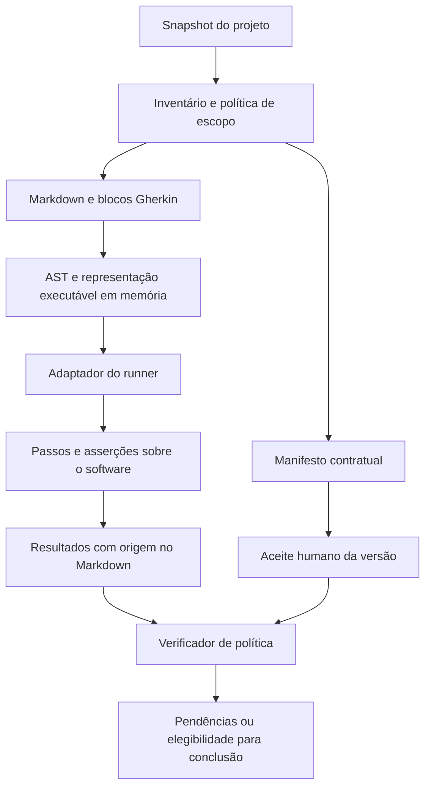

# Arquitetura proposta

Este documento descreve uma proposta para implementação. Há [protótipos de integração com runners](runner-feasibility.md), mas não há núcleo de produto, plugin, serviço de aceite ou bloqueio protegido implementado ou validado neste repositório. A publicação desta documentação não constitui aceite contratual do seu conteúdo.

Leia também [produto](product.md), [requisitos](requirements.md), [formato](format.md), [aceite e confiança](approval-and-trust.md), [indexação](indexing.md), [integrações](integrations.md), [roadmap](roadmap.md) e [plano de validação](validation-plan.md).

## Restrição central: Markdown é a fonte canônica

O contrato é escrito, revisado e versionado em Markdown. Seus cenários Gherkin ficam no mesmo documento que explica os requisitos correspondentes.

A execução proposta não depende de arquivos `.feature`, nem mantidos pelo desenvolvedor nem gerados temporariamente como etapa obrigatória. O adaptador deve extrair os blocos do Markdown e fornecer uma representação executável em memória ao mecanismo de execução. Os runners Cucumber usuais não devem ser presumidos capazes de descobrir ou executar Markdown diretamente.

A viabilidade inicial dessa integração foi demonstrada nos protótipos Java, Python e Go; estabilidade das APIs, cobertura da gramática e integração com projetos reais continuam exigindo validação. Se um runner escolhido exigir arquivos `.feature`, essa integração ainda não satisfaz o requisito do produto; o projeto deverá escolher outro ponto de integração, adaptar o executor ou rever a escolha do runner com decisão explícita. Gerar uma segunda especificação editável não é uma solução aceita para esse problema.

As implementações dos passos continuam sendo código de teste. Elas exercitam o software e fazem as asserções descritas nos cenários; não se tornam uma segunda fonte de requisitos em linguagem natural.

## Componentes e responsabilidades

| Componente | Responsabilidade | Fonte de confiança |
| --- | --- | --- |
| Inventário | Descobrir documentos no escopo e acompanhar caminhos, identificadores, hashes e relações. | Arquivos efetivos e política de escopo autorizada. |
| Assistente de classificação | Sugerir documento comportamental, informativo ou misto e apontar possíveis obrigações sem cenário. | Sugestões sujeitas à revisão; não concede dispensa. |
| Parser de Markdown | Identificar metadados, requisitos e blocos Gherkin, preservando a origem de cada elemento. | Parsing determinístico do snapshot selecionado. |
| Parser/compilador Gherkin | Validar a sintaxe e produzir a representação dos cenários. | Implementação e versão fixadas no ambiente de verificação. |
| Adaptador de execução | Entregar cenários em memória ao runner e relacionar seus resultados às origens no Markdown. | Integração testada e identificada no relatório. |
| Executor | Executar passos e registrar resultados, passos indefinidos, falhas, cenários ignorados e bloqueios. | Execução da revisão identificada, com configuração identificada. |
| Autoridade de aceite | Registrar decisão humana autenticada sobre um contrato específico. | Canal e permissões separados dos do agente. |
| Verificador de política | Conferir escopo, classificação, aceite e evidências aplicáveis à tarefa. | Política e raízes de confiança protegidas. |
| Adaptadores dos agentes | Acionar verificações nos eventos disponíveis e devolver pendências úteis. | Integração específica por plataforma; hooks locais não são a autoridade final. |
| Gate de integração | Recusar uma mudança que não atende à política na revisão que será integrada. | Execução protegida fora do controle da credencial do agente. |
| Índice e cache | Evitar descoberta, parsing e análises repetidas. | Dados derivados, reconstruíveis e verificáveis. |

O núcleo deve ser utilizável por CLI com resultados estruturados. Os plugins conectam esse núcleo aos agentes; não mantêm implementações diferentes das regras de aceite para cada plataforma.

## Pipeline de execução sem `.feature`

Cada cenário executável deve preservar pelo menos:

- Identificador do documento e do requisito ao qual está vinculado.
- Identificador estável do cenário e tags aplicáveis.
- Caminho do Markdown e posição do bloco e do cenário para diagnóstico.
- Hash do contrato e revisão do código usados na execução.
- Versão do parser, adaptador, runner e configuração pertinente.

Linhas e colunas ajudam a navegar, mas não servem como identidade estável: inserir um parágrafo pode deslocá-las. Os identificadores e o conteúdo do contrato devem permanecer distinguíveis das posições de apresentação.

O protótipo deve validar, sem arquivos `.feature`, pelo menos cenários simples, idioma português, tags, passos indefinidos e mapeamento de falhas para o Markdown. Suporte a `Background`, `Scenario Outline`, tabelas e doc strings precisa ser demonstrado ou declarado como não suportado na versão inicial. Esses nomes descrevem conceitos Gherkin, não uma API de integração já escolhida.

## Quatro estados que não devem ser confundidos

### Contrato

Contém o texto e os cenários que definem o comportamento pretendido. Sua classificação também é uma afirmação sujeita ao aceite: declarar um documento como informativo não deve conceder automaticamente uma dispensa.

Uma nova versão pode estar em rascunho, aguardando aceite, aceita, revogada ou substituída. Os nomes finais desses estados ainda serão definidos no esquema de dados.

### Aceite

É uma decisão autenticada sobre uma versão identificada do contrato. O agente pode preparar uma solicitação; não pode produzir a decisão humana. Alterações no contrato criam uma nova versão pendente. O aceite anterior continua sendo um fato histórico, mas não autoriza a alteração.

### Evidência de execução

Registra o que foi executado e os resultados obtidos para um snapshot de código, contrato e ferramentas. Um contrato aceito pode ainda não ter evidências ou possuir cenários falhando. Um cenário pode passar para um contrato ainda não aceito. Nenhuma dessas situações permite confundir concordância com verificação.

### Índice e cache

São projeções para descoberta, navegação e desempenho. Não concedem aceite nem tornam resultados antigos atuais. Podem ser apagados e reconstruídos sem perder decisões humanas ou o histórico auditável.

## Snapshot, manifesto e referências

O manifesto contratual identifica o conjunto relevante de documentos, seus caminhos e SHA-256 dos conteúdos exatos. Sua serialização deve ser determinística e versionada. O hash agregado identifica o conteúdo do contrato, não comprova sua aprovação.

A base de referência para o gate protegido deve ser uma revisão Git imutável. Para desenvolvimento local com alterações não commitadas, o núcleo pode produzir um snapshot por conteúdo que inclua os arquivos novos no escopo, mas precisa deixar claro a qual estado local o resultado pertence.

O inventário deve tratar adições, remoções e renomeações. Referências normativas entre documentos precisam ser resolvidas dentro do conjunto identificado ou declaradas como dependências com identidade e versão conhecidas; uma referência mutável não pode modificar silenciosamente o contrato aceito.

Os registros de aceite e relatórios de execução não compõem o próprio conteúdo que estão atestando. Incluí-los recursivamente no manifesto causaria autorreferência. Eles podem residir no repositório como artefatos verificáveis, ou em armazenamento externo, conforme a decisão de implementação.

A política que define quais arquivos fazem parte do contrato também é protegida. Alterar exclusões, glob patterns ou classificação não pode retirar uma obrigação do alcance do verificador sem a revisão exigida.

## Validade e invalidação

| Evento | Aceite do contrato | Evidência de execução | Cache |
| --- | --- | --- | --- |
| Documento contratual ou cenário muda | Nova versão requer aceite. | Resultados anteriores não verificam automaticamente a nova versão. | Invalidar análises afetadas. |
| Documento informativo protegido muda | Classificação e conteúdo alterado voltam à revisão. | Reavaliar apenas obrigações afetadas. | Invalidar a análise pertinente. |
| Código de implementação muda | Permanece válido se o contrato é o mesmo. | Renovar evidências afetadas para o novo snapshot. | Invalidar dependências afetadas. |
| Passos, asserções ou configuração de teste mudam | Não muda por si só o contrato; a alteração pode exigir revisão técnica. | Renovar e identificar a nova versão executada. | Invalidar resultados dependentes. |
| Política, escopo ou raiz de confiança muda | Reavaliar a autorização aplicável; não adotar a mudança silenciosamente. | Reavaliar validade conforme a política vigente. | Invalidar resultados afetados. |
| Índice local é removido | Não altera decisões humanas. | Não altera a existência das evidências verificáveis. | Reconstruir. |

A seleção de testes por impacto depende da qualidade das relações conhecidas. Um grafo incompleto não demonstra que uma mudança é irrelevante. A política inicial deve preferir verificações mais abrangentes quando não houver informação suficiente.

## Gates e experiência do agente

Os pontos lógicos de controle são:

1. **Antes de implementar comportamento pendente:** verificar se o contrato aplicável recebeu aceite. O alcance do bloqueio deve ser explícito: tarefa, atividades dependentes ou projeto.
2. **Durante o trabalho:** atualizar o inventário e devolver pendências incrementais, evitando repetir toda a suíte a cada edição de documentação.
3. **Antes de declarar conclusão:** reconciliar o estado atual, conferir aceites e exigir evidências válidas para as obrigações aplicáveis.
4. **Antes de integrar:** repetir a verificação no snapshot que será efetivamente integrado, por um mecanismo protegido.

`waiting_human_review` é uma parada válida. O agente precisa conseguir apresentar a proposta e devolver o controle ao usuário sem declarar a tarefa concluída. Um hook que impeça qualquer encerramento enquanto depende do humano criaria um ciclo improdutivo.

Uma pendência deve indicar documento, requisito ou cenário, motivo do bloqueio, versão envolvida e próxima ação esperada. Exemplos: contrato alterado sem aceite, documento sem classificação, passo indefinido, cenário ignorado, evidência de outro snapshot ou ambiente indisponível.

Os eventos e garantias reais de Claude Code e Codex precisam ser verificados separadamente. Esta arquitetura não pressupõe equivalência de hooks nem capacidade universal de impedir uma sessão de terminar.

## Limites e decisões abertas

- Hashes e assinaturas não avaliam se os cenários representam toda a intenção do usuário.
- Uma suíte verde não demonstra que suas asserções são fortes ou que um passo não foi implementado de forma vazia.
- A análise com IA pode sugerir requisitos omitidos, contradições e classificações suspeitas; isso não equivale a uma prova determinística de completude.
- O agente não pode receber as mesmas permissões de aprovação e administração usadas para aplicar os gates que o limitam.
- A stack, o formato final dos envelopes, o canal de aceite, o runner e sua integração em memória continuam decisões de implementação a validar.

O [roadmap](roadmap.md) e o [plano de validação](validation-plan.md) devem transformar esses riscos em experimentos antes de prometer compatibilidade ou proteção em produção.
