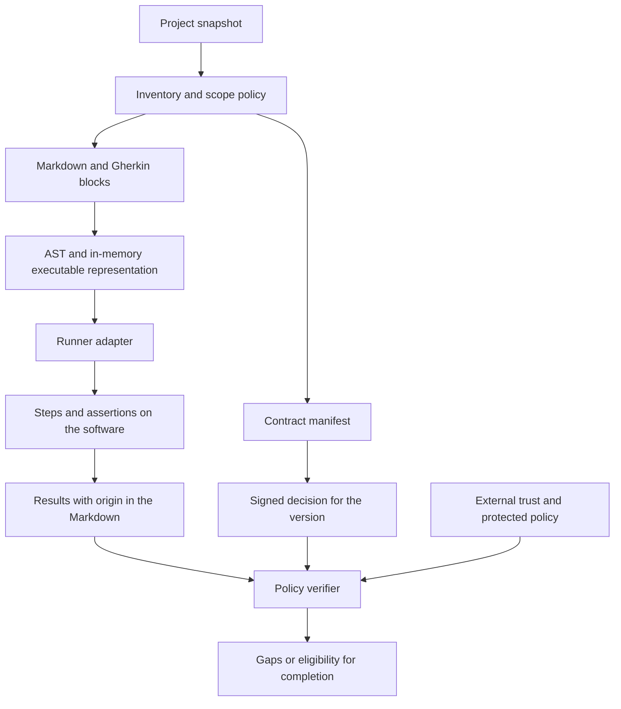

# Experimental architecture and product design

> **Historical, predates [D-021](decisions.md).** This document describes the design with signed acceptance, authority, trust and implementation blocking, removed on 23/10/2026. For the current product, see [product](product.md) and [implementation status](implementation-status.md).

The project already implements inventory, contract parsing, review proposals, Ed25519 decisions, scenario execution and evidence evaluation in an experimental Python cycle. There are agent adapters and [runner research](runner-feasibility.md). The [implementation status](implementation-status.md) distinguishes these capabilities from installation proofs and open gaps; the [first Codex preflight](experimental-codex.md) documents the previous increment.

The local cycle does not authenticate the human identity nor establish authority isolation. There is no production approval service or GitHub/OAuth authentication. The verification command implements conditions for protected execution, but a trustworthy integration gate depends on a package, workflow, policy and permissions provisioned outside the agent's control. Publishing this documentation does not constitute contractual acceptance of its content.

See also [product](product.md), [requirements](requirements.md), [format](format.md), acceptance and trust (removed by [D-021](decisions.md)), [indexing](indexing.md), [integrations](integrations.md), [roadmap](roadmap.md) and [validation plan](validation-plan.md).

## Central constraint: Markdown is the canonical source

The contract is written, reviewed and versioned in Markdown. Its Gherkin scenarios live in the same document that explains the corresponding requirements.

The implemented execution extracts Gherkin blocks from the Markdown and provides content and origin in memory to the adapters, without requiring maintained or temporary `.feature` files. The Python worker integrates Behave; Java and Go use configured bridge commands, whose protocol and implementation must match the chosen runtime. Cucumber runners must not be presumed capable of reading any Markdown syntax directly.

The initial feasibility of this integration was demonstrated in the Java, Python and Go prototypes; API stability, grammar coverage and integration with real projects still require validation. If a chosen runner requires `.feature` files, that integration does not yet satisfy the product requirement; the project will have to choose another integration point, adapt the executor or revisit the runner choice with an explicit decision. Generating a second editable specification is not an accepted solution to this problem.

The step implementations remain test code. They exercise the software and make the assertions described in the scenarios; they do not become a second source of requirements in natural language.

## Components and responsibilities

| Component | Current implementation | Boundary and limitations |
| --- | --- | --- |
| Inventory and Markdown parser | Discovery, metadata, requirements, blocks, hashes and origin in `core.py`. | The scope policy and the snapshot must match the intended environment. |
| Classification | `behavioral`, `reference` and `mixed` declarations go into the review. | AI-based semantic classification is not implemented; declaring is not the same as accepting. |
| Gherkin parser | Parsing, IDs and scenario instances in the core. | Recognizing syntax and links does not prove coverage of the prose. |
| Execution adapters | Python/Behave worker and protocol for Java/Go bridges in `runner.py`. | Step code is not sandboxed; bridge provenance and assertion strength need review. |
| Review | Proposals with exact text and a local interface. | The person's identity field is self-declared; there is no human login through a provider. |
| Signed decisions | Ed25519, context, key revocation and external record of the current decision in `authority.py`. | Initialization produces only `local_demo`; a signature proves an authorized key, not human authentication. |
| Cycle and evidence | `workflow.py` relates contract, code, links, decision and results. | State reused locally does not grant protected approval. |
| Agent adapters | Codex-specific and Claude Code-specific integrations. | Protocol and per-host proofs are in the implementation status; there is no universal equivalence between events. |
| Protected verification | The `verify` path requires a current real run, protected trust and strict links. | Operational protection of the package, the workflow and the policy must exist outside the agent. |
| Index and cache | Derived local data for observation and performance. | Can be rebuilt; does not constitute an approval authority. |

The core is usable through a CLI with structured results. The adapters connect that core to the agents; they do not maintain distinct acceptance authorities per platform.

## Execution pipeline without `.feature`

Each executable scenario must preserve at least:

- The identifier of the document and of the requirement it is linked to.
- A stable scenario identifier and the applicable tags.
- The Markdown path and the position of the block and of the scenario, for diagnostics.
- The contract hash and the code revision used in the run.
- The version of the parser, adapter, runner and pertinent configuration.

Lines and columns help navigation, but do not serve as a stable identity: inserting a paragraph can shift them. The identifiers and the contract content must remain distinguishable from presentation positions.

The current core also represents `Rule`, `Background` and `Scenario Outline` instances, preserving links and origin. The grammar accepted by the parser does not guarantee execution parity across all runtimes; each bridge must demonstrate the subset it runs. Empty results and missing, undefined or skipped scenarios do not count as a successful run.

## Four states that must not be confused

### Contract

Contains the text and scenarios that define the intended behavior. Its classification is also a claim subject to acceptance: declaring a document as informational must not automatically grant an exemption.

A review proposal identifies content and scope by a deterministic hash. Changing documentation, classification, configuration or the link map creates a different identity. The results of the implemented cycle appear in the states section below.

### Acceptance

The implemented mechanism records a signed decision about a version and context. The key must be authorized for the project/repository and not revoked; the external record pins the current decision. The previous acceptance remains historical and does not authorize new content. In local mode, the name provided is self-declared and the key may be accessible to the same identity as the agent: this does not satisfy the intended guarantee of isolated human acceptance.

### Run evidence

Records what was run and the results obtained for a snapshot of code, contract and tools. An accepted contract may not yet have evidence, or may have failing scenarios. A scenario may pass for a contract not yet accepted. None of these situations allows confusing agreement with verification.

### Index and cache

These are projections for discovery, navigation and performance. They do not grant acceptance nor make old results current. They can be deleted and rebuilt without losing human decisions or the auditable history.

### States of the implemented cycle

- Schema 1 remains a structural preflight without completion authorization.
- In schema 2, `waiting_human_review` indicates the absence of a valid decision and `awaiting_evidence` indicates missing, expired or incompatible evidence.
- `blocked` and `error` identify failures that cannot silently turn into success.
- `demo_passed` allows experimenting with the local flow, but does not satisfy the protected verification.
- `passed` requires a valid decision under trust configured as protected, a current real run and a strict traceability policy. The signature mode, the validity of the results and the operational protection remain distinct dimensions.

`verify` runs again by default. A coherent local JSON or a previous demonstration does not replace that run. Even when the predicate returns `passed`, it presupposes a trusted verifier, policy and result producers; it does not automatically audit the environment that runs it.

## Snapshot, manifest and references

The contract manifest identifies documents, paths and the SHA-256 of the exact contents, as well as the configuration and, in schema 2, the traceability map. The serialization is deterministic and versioned. The aggregate hash identifies content and scope; it does not prove approval or semantic adequacy.

The reference base for the protected gate must be an immutable Git revision. For local development with uncommitted changes, the core can produce a content-based snapshot that includes the new in-scope files, but it must make clear which local state the result belongs to.

The inventory must handle additions, removals and renames. Normative references between documents must be resolved within the identified set or declared as dependencies with a known identity and version; a mutable reference cannot silently modify the accepted contract.

Receipts live in `.specmd/approvals/` and are verified against external trust; local evidence and status live in `.specmd/local/`. These artifacts are not recursively included in the content they attest. The private key and `trust.json` live outside the checkout. The external location is necessary, but does not prove that the agent has no permissions over them.

With `repository_id`, the signature uses `repo:<repository_id>` to allow another checkout or CI. `workspace_root` still identifies the current physical root in order to validate file boundaries and the trust location, without becoming part of the proposal's portable digest. Without a configured logical identity, the binding uses the absolute path.

The trust keeps `latest_decisions` per proposal. A superseded decision, a current rejection or a revoked key prevent reusing the previous acceptance. The optional chaining by receipt hash helps relate events, but does not implement an immutable audit service.

The policy that defines which files are part of the contract is also protected. Changing exclusions, glob patterns or classification cannot remove an obligation from the verifier's reach without the required review.

## Validity and invalidation

| Event | Contract acceptance | Run evidence | Cache |
| --- | --- | --- | --- |
| Contract document or scenario changes | The new version requires acceptance. | Previous results do not automatically verify the new version. | Invalidate affected analyses. |
| Protected informational document changes | The classification and the changed content go back to review. | Re-evaluate only the affected obligations. | Invalidate the pertinent analysis. |
| Implementation code changes | Remains valid if the contract is the same. | Renew the affected evidence for the new snapshot. | Invalidate affected dependencies. |
| Steps or assertions change | Does not by itself change the contract; requires proper technical review. | Renew and identify the new version that was run. | Invalidate dependent results. |
| Configuration or link map changes | Part of the reviewed identity; requires a decision applicable to the new version. | Renew incompatible results. | Invalidate dependent results. |
| Policy, scope or trust root changes | Re-evaluate the applicable authorization; do not adopt the change silently. | Re-evaluate validity according to the current policy. | Invalidate affected results. |
| Local index is removed | Does not change human decisions. | Does not change the existence of verifiable evidence. | Rebuild. |

Impact-based test selection depends on the quality of the known relations. An incomplete graph does not demonstrate that a change is irrelevant. The initial policy should prefer broader verifications when there is not enough information.

## Gates and agent experience

The logical control points are:

1. **Before implementing pending behavior:** check whether the applicable contract has received acceptance. The scope of the block must be explicit: task, dependent activities or project.
2. **During the work:** update the inventory and send back incremental gaps, avoiding rerunning the whole suite on every documentation edit.
3. **Before declaring completion:** reconcile the current state, check acceptances and require valid evidence for the applicable obligations.
4. **Before integrating:** repeat the verification on the snapshot that will actually be integrated, through a protected mechanism.

`waiting_human_review` is a valid stop. The agent must be able to present the proposal and return control to the user without declaring the task complete. A hook that prevents any ending while depending on the human would create an unproductive loop.

A gap must indicate the document, requirement or scenario, the reason for the block, the version involved and the expected next action. Examples: contract changed without acceptance, document without classification, undefined step, skipped scenario, evidence from another snapshot or unavailable environment.

The actual events and guarantees of Claude Code and Codex are verified separately. This architecture does not presuppose equivalent hooks nor a universal ability to prevent a session from ending. The evidence and limits of each integration are in [implementation status](implementation-status.md).

Running the PR's own verifier with the same permissions as the agent does not turn it into a protected gate. A trusted version of the package/workflow must be pinned and the policy enforced outside that control. An arbitrary bridge command can declare false results; classifying it as a `real` run in the protocol does not establish its provenance. Review of the executors and isolation of the acceptance credentials remain necessary.

## Limits and open decisions

- Hashes and signatures do not assess whether the scenarios represent the user's whole intent.
- A green suite does not demonstrate that its assertions are strong or that a step was not implemented as a no-op.
- AI analysis can suggest omitted requirements, contradictions and suspicious classifications; this is not equivalent to a deterministic proof of completeness.
- The explicit map links files, requirements and scenarios; it does not prove equivalence between implemented behavior and accepted intent.
- The agent must not receive the same approval and administration permissions used to enforce the gates that constrain it.
- The local implementation uses Python, Ed25519 envelopes and in-memory executors; schema stabilization, human authentication through an external channel and protected production deployment remain pending.

The [roadmap](roadmap.md) and the [validation plan](validation-plan.md) must turn these risks into experiments before promising compatibility or protection in production.
